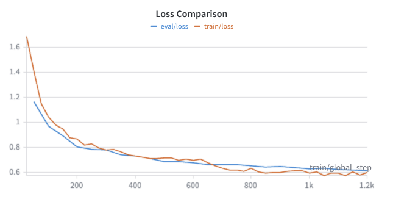
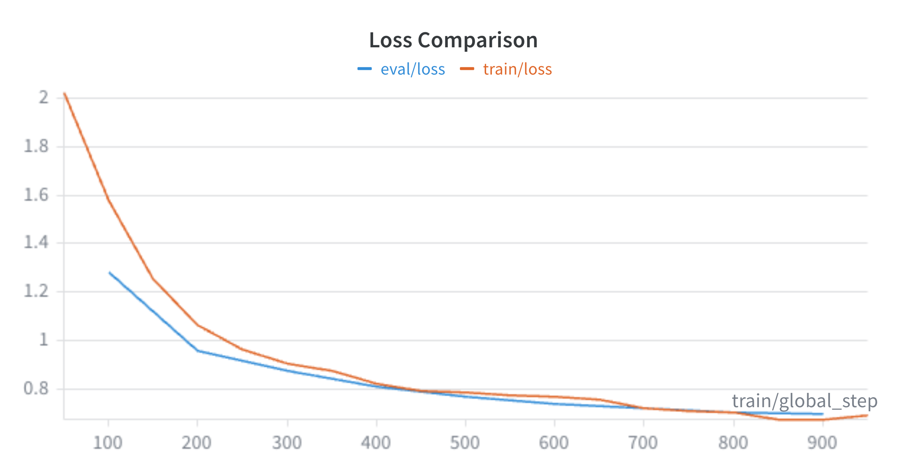

# Consensus vs. Dissent (2026)

**Repository for the paper:** *Consensus vs. Dissent: Dynamic LLM Modeling of Subjective Preferences in Group Recommenders*
Accepted at **ACM RecSys 2026**

This repository provides the data, source code, and training pipelines for analyzing how Large Language Models (LLMs) model subjective preferences in group recommender scenarios.

---

## Resources
*   **[OSF Pre-registration](https://osf.io/98kuw/overview?view_only=41c006b50fb84f0abb76347c98e94ff9)**: Detailed documentation of the user evaluation study.
*   **[Original Dataset](https://dataverse.nl/dataset.xhtml?persistentId=doi:10.34894/8EVX4U)**: Dataset from previous work used in this study (before data augmentation)
---

## Project Structure

| Component | Description |
| :--- | :--- |
| `strats` | Implementation of social choice-based aggregation strategies. |
| `config_gen` | Script to generate group configurations (Uniform, Divergent, Coalitional, Minority). |
| `basemodels` | LLM-as-a-judge pipelines (compatible with Cerebras, Ollama, and Huggingface). |
| `finetune.py` | Core training script for supervised fine-tuning (SFT). |
| `training_augment.py` | Generates chain-of-thought reasoning alongside ground truth human scores. |
| `user_study_LLM_assessments` | Raw LLM assessments for the 16 scenarios used in our user study. |

**Datasets:**
*   `train_v5_3.jsonl`: Augmented training data used for fine-tuning.
*   `test_v5_2.jsonl`: Held-out test set for model evaluation.

---

## LLM-as-a-Judge Pipeline

We utilize a structured prompt-based approach to elicit fairness assessments on a 7-point Likert scale.

> **System Message**
> You are a participant in a scientific study. You will be presented with scenarios regarding group restaurant recommendations. Answer using a 7-point Likert scale (-3: strongly disagree, 0: neutral, 3: strongly agree). Return **ONLY** a valid JSON object: `{"fairness": <int>}`.

*(See repository source for the full scenario prompt template, which includes the restaurant rating matrix, constraint history, and the system recommendation.)*

---

## Fine-tuning Methodology

We performed Supervised Fine-Tuning (SFT) using `transformers` over 4 epochs (80/20 train-test split). We employed a custom masking function (`create_weighted_labels`) to ensure loss calculation is restricted to the model's output tokens.

### Model Hyperparameters

| Model | Learning Rate | LoRA Rank | LoRA Alpha |
| :--- | :--- | :--- | :--- |
| **Llama** | $1e-4$ | 16 | 32 |
| **Olmo3** | $2e-5$ | 16 | 32 |

*   **Shared Parameters:** `lora_dropout: 0.1` | `grad_accum: 4` | `max_seq_length: 1275`

#### Training Metrics

*Figure 1: Llama Fine-tuning loss trajectory.*


*Figure 2: Olmo3 Fine-tuning loss trajectory.*

---

## Citation
If you find this work useful, please consider citing our paper:

full citation TBA

```bibtex
@inproceedings{10.1145/3773078.3831775,
author = {Waterschoot, Cedric and Tintarev, Nava and Barile, Francesco},
title = {Consensus vs. Dissent: Dynamic LLM Modeling of Subjective Preferences in Group Recommenders},
year = {2026},
isbn = {9798400722844},
publisher = {Association for Computing Machinery},
address = {New York, NY, USA},
url = {https://doi.org/10.1145/3773078.3831775},
doi = {10.1145/3773078.3831775},
booktitle = {Proceedings of the 20th ACM Conference on Recommender Systems},
pages = {135–144},
numpages = {10},
keywords = {Large Language Models, Fairness, Group Recommender Systems, LLM-as-judge, User study},
series = {RecSys '26}
}
